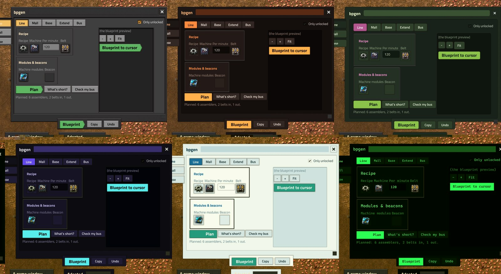
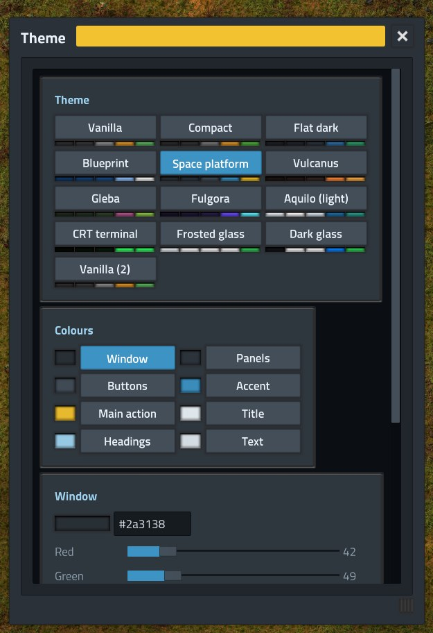
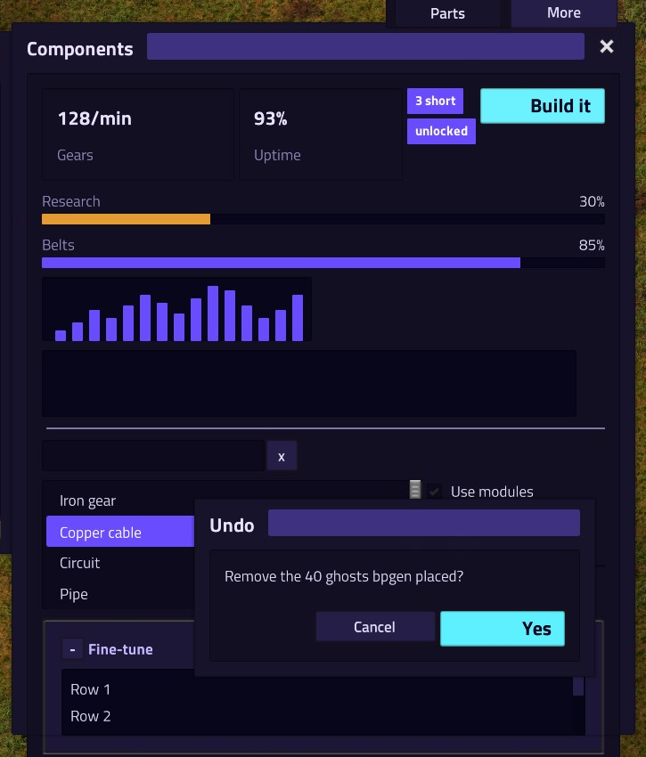
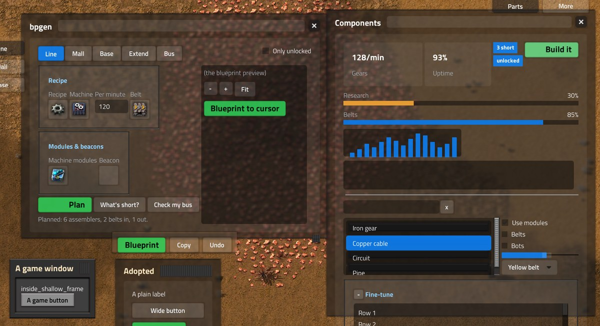
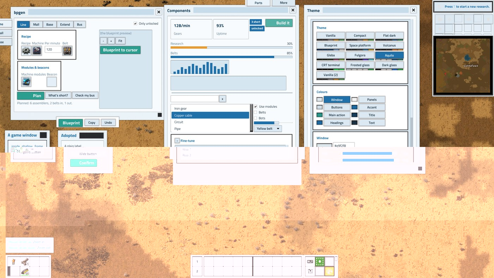
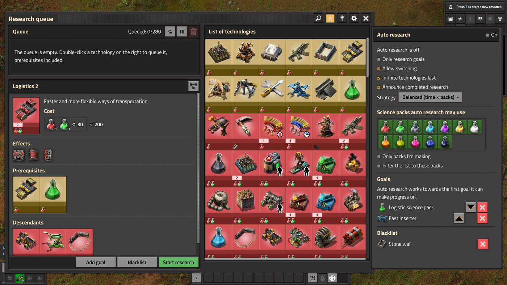

# FSE (Factorio Script Extender)

A native extension layer for Factorio 2.0 on Windows. Native code (Rust, C, anything with a C ABI, and Python) runs
inside the game and Lua mods reach it through a global `native` table. With it, mods can do things the Lua API
can't: read the mouse, use the clipboard, run work on threads, call Python libraries, show web pages over the game,
profile engine functions and patch small engine bugs.

Installing is unzipping into the game's folder; uninstalling is deleting what that added. No launcher, no Steam
launch options: a small `version.dll` beside `factorio.exe` (Windows loads it from the game's folder) loads
`fse.dll` before the game starts. fse finds the engine's functions by name in `factorio.pdb`, the debug symbols Wube
ships with the game, so game updates need no new offsets, and Steam updates leave the install alone.

> **Multiplayer works** when every player and the server run the same FSE (see *Multiplayer* below: a player
> without it is kicked with a message saying so). Windows only. Not for the mod portal (it can't carry native
> binaries). Keep crash-report uploading off while you experiment: crashes with foreign code in the process are
> noise for Wube.

> **For mod developers: hot reload.** Edit your mod and see the change in your running game, without restarting it
> yourself or reloading the save. Add one line to `fse.env`:
>
> ```
> FSE_HOTRELOAD=C:\dev\my-mods
> ```
>
> - **control.lua:** saved → in the game within half a second. `storage` is kept, `on_load` runs, and chat says
>   `[hot reload] my-mod reloaded`.
> - **Syntax error:** refused. Chat shows the error with file and line, and the old code keeps running. No crash
>   to the main menu.
> - **data.lua, settings, locale, graphics:** these load only when the game starts, and you usually change several
>   files. So the mod is held, and a red restart icon appears with your other mod buttons top left (its tooltip names the mods and files). Press it when your edits
>   are done. The game saves and restarts on that save (about 10 s on a small modlist) with the new prototypes and
>   code. A tool or AI agent can press it too: `remote.call("fse-hotreload", "restart")`, for example over fse's
>   web API.
>
> Singleplayer only. The mod must be installed as a folder, not a zip. Details: `fse-hotreload` below.

## Getting started

### 1. Install

You need Windows 10/11 and Factorio 2.0 (Steam or standalone). For the `py` plugin, also
[Python](https://www.python.org) 3.10 to 3.13 on `PATH`.

1. Download `fse-<version>-windows.zip` from [Releases](https://github.com/watdafawx/fse/releases).
2. Open the game's folder. Steam: Library → right-click Factorio → Manage → Browse local files.
3. Extract the zip there. It adds `bin\x64\version.dll` (the loader) and an `fse` folder.
4. Start the game as always.

At the first start fse puts its mods into your mods folder (newer versions too, at later starts):

| mod | what it does |
|---|---|
| `fse-std` | GUI library for other mods: movable, resizable windows that remember their place and close with Esc, drag & drop, themes each player picks and recolours live (`/fse-theme`), and a window size of their own on top of the game's UI scale (per-player setting "Window size"). Works without fse too (no resize grip; click to pick, click to drop; theme colours only on a theme switch). |
| `fse-hub` | an **F** button (top left, single player) opening the FSE Hub window, its views on a rail by its left edge (settings behind the gear: Docked, Size, Theme..., Reset size and place; Esc closes it): loader and plugins, your mods (added/updated dates, real load order, portal updates), the start-up time report per mod, the engine profiler, and **Get mods**: the fse mod catalog ([fse-mods](https://github.com/watdafawx/fse-mods)), installed with one click and checked against the index's sha256 (they load at the next start). Needs `fse-std`. |
| `fse-bridge` | runs commands from the local web API on the game thread, and sends events out to [remote mods](#remote-mods-a-program-outside-the-game-any-language) (programs outside the game). |
| `fse-agent` | characters without a player that an external program (an AI agent, `examples/agent_client.py`) can drive. |
| `fse-hotreload` | for mod developers: list your mods' source folders in `fse.env` (`FSE_HOTRELOAD`); saving a file copies the mod over its installed folder and the running game reloads its control.lua within half a second (`game.reload_script`: `storage` kept, `on_load` runs). Changed files are compiled first, so a syntax error shows in chat and the old code keeps running. A data.lua, settings, locale or graphics change holds the mod (nothing copied or reloaded, so new code never runs against old prototypes) until you press the red restart icon (top left, with the other mod buttons) or call `remote.call("fse-hotreload", "restart")`. Then the game saves (`_autosave-hotreload`) and restarts on that save, about 10 s for a small modlist; prototypes only load at start. Edits made while the game was closed are picked up at the next start (the source is compared with the installed copy). Singleplayer only, needs `python` on PATH for the restart, and the installed mod has to be a folder, not a zip. |

Every mod checks for fse first and does nothing (or falls back) without it.

Settings go in `fse\fse.env` (optional: copy `fse\fse.env.example` to it and see the comments; unzipping a newer
release over the install never replaces it). The log is `fse\fse.log`. A good start:

```
fse 0.10.0 loading
105032 engine symbols read in 61.48ms
game build EAAB184A...-1 (known)
plugin ...\fse_std.dll: init ok
ready in 70.97ms
```

**Updates:** when a newer fse is out, the hub says so (its Hub tab, the dashboard behind **FSE hub** in the menus,
and once in the chat). **Update** downloads it from the GitHub release, checks it against the release's sha256 and
installs it over this one (your `fse.env` stays); the game uses it from its next start.

**Off for one start:** set `FSE_OFF=1` in the environment. **Uninstall:** run `fse\uninstall.cmd`, or delete
`bin\x64\version.dll` and the `fse` folder. The mods stay; disable them in the game if you like.

### 2. Build from source

Needs [Rust](https://rustup.rs) (stable, MSVC toolchain) and Python. Optional: `clang-cl` (LLVM) for the C example
plugin, the WebView2 runtime (part of Windows 11) for pages in a panel over the game (else they open in your browser).

```
git clone https://github.com/watdafawx/fse
cd fse
python build.py
python install.py
```

`build.py` puts everything in `dist\`, laid out like the install: `bin\x64\version.dll` (the loader), `fse.dll`
(the core), `plugins\*.dll` (`py`, `std`, `web`, `profiler`, `fixes`, `diag`, `entityinfo`, and `hello` if clang-cl
was found), `py\`, `mods\`, `web\` and `fse.env` (created once, never overwritten). `install.py` copies the loader
into the game and makes the game's `fse` folder a junction to `dist\`, so each rebuild is live at the next start;
`install.py --remove` undoes it. `package.py` makes the release zip.

`dist\fse-launcher.exe` is the launcher the tests use: it starts the game and injects `fse.dll` (from beside itself) with
nothing installed. Pass it any Factorio arguments; it finds the game in the usual Steam libraries, or set
`FACTORIO_EXE`.

### 3. Check it works

In game, open the console and run:

```
/c game.print(native and native.version() or "no loader")
```

Or click the **F** button if you installed `fse-hub`. In the game's main menu and pause menu (Esc), **FSE hub** (under Settings)
opens the dashboard.

## Settings (`fse\fse.env`)

One `KEY=value` per line, read at every start (by the loader, or the launcher beside `dist\fse-launcher.exe`).

| key | default | does |
|---|---|---|
| `FACTORIO_EXE` | the first Steam library that has the game | the game the launcher starts |
| `FACTORIO_MODS` | the game's own (`--mod-directory`, else its config) | the mods folder fse's mods go into, and the mod manager and start-up report read |
| `FSE_PYPATH` | | more folders with Python modules Lua can call, `;`-separated (fse's `py` folder is always there) |
| `FSE_PLUGINS` | `fse\plugins` | where plugins are loaded from; empty loads none |
| `FSE_LOG` | `fse\fse.log` | the log file |
| `FSE_WEB_PORT` | 18790 | the local web API's port (it takes the first free one of 18790-18799) |
| `FSE_PANEL=0` | | open pages in the browser instead of the panel over the game |
| `FSE_SHELL_LIVE=0` | | don't reload shell pages when their files are saved |
| `FSE_MENU_BUTTON=0` | | no **FSE hub** button in the game's main and pause menus (then the overlay buttons below show instead) |
| `FSE_OVERLAY=0` | | no hub buttons over the main menu when the menu button can't be added (to hide just one, use the dashboard's *Main menu buttons*) |
| `FSE_STD_WHEEL=0` | | don't watch the mouse wheel (the `std` plugin's wheel events) |
| `FSE_FIXES=0`, `FSE_FIX_<NAME>=0` | | turn off all engine fixes, or one |
| `FSE_DIAG=1` | | log every engine error the game raises, even ones it catches itself |

## Using it from a mod

`native` exists in every Lua state (settings, data and control stage of every mod) when fse is installed
(or the game was started through the launcher). Always check for it, so your mod still works without it:

```lua
if native then
  native.log("hello from " .. script.mod_name)
  local out, err = native.call("std", "clipboard_get")
end
```

| function | does |
|---|---|
| `native.version()` | the core's version |
| `native.log(text)` | a line in fse.log |
| `native.plugins()` | `{ plugin = { function names } }` |
| `native.call(plugin, fn, input?)` | runs on the game thread; returns the output string, or `nil, error` |
| `native.start(plugin, fn, input?)` | runs on a worker thread (for functions registered as thread-safe); returns a job id |
| `native.poll(id)` | `"pending"`, `"done", output` or `"error", message`; a result is handed out once |
| `native.to_json(value, skip?)` | any Lua value as JSON, much faster than `helpers.table_to_json`; works in the data stage too (`data.raw`); `skip = {key = true}` leaves keys out at any depth |
| `native.symbols(part, limit?)` | engine function names containing `part` |
| `native.build()` | `{ build = "...", new = true }` on the first start of a new game build |
| `native.read(target, path?, depth?)` | an engine object's field, decoded (below) |
| `native.layout(class)` | an engine class as this build has it: `{name, size, fields = {{name, offset, type}}}` |
| `native.metatable(object)` | a game object's metatable, past its protection (`fse-std`'s `extend` uses it) |
| `native.sync(key, data)` | sends `data` (a string) from this peer's player to every peer: the `fse-sync` event `{player_index, key, data}` (multiplayer, below) |
| `native.local_player()` | this peer's own player index, or nil (headless server, menu) |
| `native.send_action(kind, text?)` | an input action as this peer's player makes it (kinds without data, like `OpenCharacterGui`, or with a text, like `WriteToConsole`; `LuaShortcut` with a shortcut's name clicks another mod's shortcut), through the game's own pipeline: every peer applies it |
| `native.root()` | the game's root objects as pointers for `native.read`: `{scenario, game, map, local_player}` |
| `native.write(target, path, value)` | writes a number or boolean field: for this peer's own state (camera, UI); writing simulation state desyncs multiplayer |
| `native.write_many(targets, {path = number})` | the same numbers into many objects of one class in one call (each field's offset found once; paths inside the object): how fse-std recolours thousands of GUI sprites |
| `native.tick_stats()` | how long the update step took: `{last_ms, avg_ms, max_ms}` (this peer's own) |
| `native.events(since?)` | events plugins sent after `since`: `{ {seq, plugin, name, data} }, newest`; without `since` just `newest` |

Rules: native functions never raise Lua errors; they return `nil, message`. Inputs and outputs are strings (JSON by
convention). Long work goes through `start`/`poll` so a tick never waits.

### Engine objects

`native.read` reads the game's own C++ objects by their field names, from the type records in `factorio.pdb`, so
it keeps working across game updates as long as the names do. A target is a game Lua object (`LuaEntity`,
`LuaPlayer`, `LuaSurface`, ...), or a pointer a read handed out (`{ptr = n, type = "Inserter"}`).

```lua
local ins = native.read(entity, "entityTarget.target")   -- {ptr = ..., type = "Inserter"}: the real class
native.read(ins, "heldStack")                             -- {count = 0, itemID = 0, stackSize = 0, ...}
native.read(ins, "prototype.name")                        -- "inserter": through a pointer and base classes
native.read(entity, "entityTarget.target.position")       -- {x = 10.5, y = 7.5}
native.read(ins, "^Entity.surface")                       -- ^Class views the object as a base or derived class
```

Paths are field names joined by dots; fields of base classes are found too, pointers are followed, and a number
indexes an array or `std::vector`. Values come back as numbers, booleans, strings (`std::string`), tables of
fields (`depth` levels deep, default 1) and pointers. Pointers to classes resolve to the object's real class via
RTTI. A bad address or unknown field returns `nil, message`; nothing is ever read unchecked. Explore with
`native.layout("Inserter")` or `fse-pdb layout Inserter` (`target\release\fse-pdb.exe`). Reading is for looking:
nothing is written.

### Multiplayer

Factorio's multiplayer is lockstep: every peer simulates the same ticks from the same input actions. Anything only
one peer knows (the mouse, the clipboard, a file, Python's answer, the clock, an engine address) must reach the game
through those input actions, or the peers drift apart (a desync). FSE gives two ways in, both arriving on every peer
in the same tick (`fse-std` raises them; it must be installed):

```lua
-- 1. engine hooks: calls the simulation made during the tick's update, at its end, in a fixed order
script.on_event("fse-event", function(e)
  for _, ev in ipairs(e.events) do  -- {plugin, name, data}
    if ev.name == "rotated" then storage.rotations = storage.rotations + 1 end
  end
end)

-- 2. local data: one peer sends it, every peer gets it
if native.local_player() == player.index then native.sync("my-mod:clock", native.call("std", "now")) end
script.on_event("fse-sync", function(e)  -- {player_index, key, data}
  if e.key == "my-mod:clock" then storage.clocks[e.player_index] = e.data end
end)
```

The rules:

- Change the game only from deterministic code (events, `on_tick`, commands) using game state, `fse-event` and
  `fse-sync`. `native.events`, `native.call` results, `native.local_player()` and the pointers `native.read` hands
  out are this peer's own: use them for what this peer shows or sends, never to change the game directly.
- What plugins keep isn't in the save: add hooks (`hooks.add`) and blocked inputs (`input.block`) in both `on_init`
  and `on_load`, so a joining player has them before its first tick. Values `native.read` reads from simulation
  objects are the same on every peer.
- Hooks on functions the render thread runs need `local = true` (they never join `fse-event`).
- `native.sync` needs a player: a headless server can't send. Keep the data small; it travels as a console command.
- In multiplayer `fse-std`'s windows and drag & drop work as they do without FSE (click to pick and drop), since
  the mouse is one peer's own.
- The handshake: every joining player's FSE sends its version and plugin list; a different one, or none within 10
  seconds, is kicked.

### Python

Put a module on `FSE_PYPATH` with functions that take a string and return a string:

```python
# mytool.py
import json
def double(s):
    return json.dumps([x * 2 for x in json.loads(s)])
```

```lua
local out = native.call("py", "mytool:double", "[1, 2, 3]")    -- "[2, 4, 6]"
```

The interpreter starts on the first call (20-40 ms) and stays, so module state persists and big data loads once.
`native.call("py", "_reload", "mytool")` reloads a module while the game runs. `print` goes to fse.log.

A function run with `native.start` holds Python's lock (the GIL) while it works, so a `native.call("py", ...)` from
the game thread waits for it, and the game stutters. For progress and other status, have the worker post it with
`fse.note(key, text)` and read it with `native.call("py", "_note", key)`, which doesn't touch Python ("" until
posted). A Rust or C extension should release the GIL while it computes (pyo3: `py.allow_threads`).
Python exceptions come back as `nil, traceback`.

### Remote mods (a program outside the game, any language)

A mod's logic can live in its own process. The program hears what the game sends out and calls back in over the
local web API. Edit it, restart it or let it crash: the game keeps running. Use it for work that's heavy, needs a
library Lua doesn't have (a solver, a database, an LLM) or that you change often.

**Status: experimental, singleplayer.** Needs the `web` plugin and the `fse-bridge` mod. In multiplayer (with players
on) the game reports no programs connected (see [below](#remote-mods-in-multiplayer)), so mods use their own Lua instead.

**Try it** (a game started through fse, a save loaded, then research something):

```
python fse/examples/remote_hello.py     # with the Python SDK; save the file while it runs and it restarts
node fse/examples/remote_hello.mjs      # the same in plain HTTP, no SDK (Node 18+)
```

#### The two halves

The mod checks for its program, sends what it needs and offers a remote interface for the answer:

```lua
local function has_planner()  -- (fse-remote comes with fse-bridge; without it, or in multiplayer: false)
  return remote.interfaces["fse-remote"] ~= nil and remote.call("fse-remote", "connected", "my-planner")
end
if has_planner() then
  remote.call("fse-remote", "emit", "my-planner/need", { force = force.name })   -- answer comes a few ticks later
else
  do_it_in_lua()
end
remote.add_interface("my-mod", { answer = function(force_name, pick) ... end })
```

The program, with the SDK (`fse_remote.py`, in fse's `py` folder):

```python
from fse_remote import Remote
r = Remote("my-planner")                      # the name connected() asks for

@r.on("my-planner/need")                      # events whose name starts with this
def need(ev):
    r.call("my-mod", "answer", ev["data"]["force"], "automation")

@r.on_connect                                 # at start, and each time the game comes back
def hello():
    r.subscribe("on_research_finished")       # game events too: they arrive as "game/on_research_finished"

r.run(watch=True)
```

`run(watch=True)` restarts the program when a `.py` beside it is saved. A save with a syntax error is refused and the
old one keeps running. A handler that raises prints its traceback and the program goes on. If the game closes or
restarts, the program waits and reconnects.

#### Protocol

Plain HTTP + JSON on `127.0.0.1:18790` with `Authorization: Bearer <token>` (the token is in `web-token.txt`), so any
language works:

| call | does |
|---|---|
| `GET /api/events?client=<name>&names=<prefix,...>&since=<next>&wait=<ms>` | long-poll (`wait` up to 25000): `{"events": [{seq, name, data}], "next", "lost"}`. Pass `next` as `since` next time; without `since` only what comes after the call. The game keeps the last 4096 events (`lost`: you missed some). A `client` counts as connected while it polls and for 3 s after |
| `POST /api/game {"interface", "function", "args"}` | `remote.call` on the game thread: `{"ok": true, "result"}` or `{"ok": false, "error"}` (10 s max) |
| `$game` `subscribe(event)`, `unsubscribe(event)` | a game event (`defines.events` name) sent out as `game/<event>`; Lua objects become `{object_name, name, unit_number, index, type, position, surface_index, level, force}`. Kept in the save. Not `on_tick` |
| Lua: `remote.call("fse-remote", ...)` `emit(name, data)`, `connected(client)`, `clients()` | send an event (any JSON-able table); is a program there |

#### What fits

A remote mod hears about things a few ticks late and its calls land a few ticks later, so it suits planners,
dispatchers, solvers, statistics and tools. It doesn't suit handlers that must change an event as it happens
(cancel a build, fix a placement), work every tick across many entities (moving the data costs more than the work),
or prototypes (`data.lua` runs before any program can talk to the game). Examples: `examples/remote_hello.py`
and `examples/remote_hello.mjs`; `test/run_web.py` checks the whole path.

#### Remote mods in multiplayer

Not yet. Multiplayer stays in sync because every peer runs the same inputs on the same tick; a program talks to one
peer, so its `POST /api/game` calls would change only that peer's game. To stay safe, `connected` is false while
players are connected to a multiplayer game (a server nobody is on runs alone, so tests can use one). A way there, for whoever needs it:

- **writes** as a hidden console command (`/fse-remote <json>`) sent with `native.send_action("WriteToConsole", ...)`,
  or over RCON on a dedicated server: the game's own input path, applied on every peer on the same tick;
- **"connected"** kept in the save: the program announces itself through that same path and sends a heartbeat, and
  silence for 3 s counts as gone;
- **reads** stay `POST /api/game`, made strictly read-only (no `storage` writes, no `math.random`).

Events going out are already safe: every peer emits them, and nothing in the game changes.

### The `fse-std` library

```lua
local window = require("__fse-std__/window")
local events = require("__fse-std__/events")
local safe   = require("__fse-std__/safe")
```

| module | gives |
|---|---|
| `window` | `create(player, {name, title, width, height, resizable, close, min_width, min_height, themed, settings, esc, fit})` → frame, content: a title bar to move it, a close button, a corner grip to resize; position and size remembered per player; Esc closes it (it becomes the player's opened GUI when nothing else is; `esc = false` for a window that stays while the player uses the game's windows); `on_close` (X and Esc), `on_resize`, `size`, `close(player, name)`, `reset_place(player, name)`; drawn at a window scale of its own (`scale`, `set_scale`, `size_setting`, `on_scale`, `room`: [Window scale](#window-scale-fse-std-08)) |
| `theme` | themed components: `add(parent, spec, role, tweak)`, `section`, `field`, `tabs`, `apply`; add `handlers` to `events.register` and the player's theme change restyles your elements (below) |
| `dnd` | `draggable(el, payload)`, `droppable(el, accept)`, `on_drop(fn)`: press, drag (a ghost follows the cursor, the target lights up), release |
| `input` | the cursor and mouse buttons (`read()`), the wheel, clipboard, real time in ms, reading files under script-output |
| `events` | `events.register({...})`: one registration per event for all of the above plus your own handlers, each guarded |
| `safe` | `guard(name, fn)` (an error is logged instead of crashing the game), `has(plugin)`, `log`, `chain` |
| `native_events` | `on(plugin, event, fn)`: events from plugins (engine hooks) to handlers; add `handlers` to `events.register` (it polls each tick) |
| `extend` | `class(sample, {name = fn})`: new properties (and `extend.method`s) on a game class like `LuaEntity`, for your mod only |
| `shell` | a window that is a web page over the game with holes ("engine islands") for the game's own widgets: `open`, `island`, `send`, `on_message` ([Shells](#shells-web-pages-with-engine-islands-pilot)) |

Add `"? fse-std"` to your mod's dependencies if it should work without it, and check
`script.active_mods["fse-std"]` before requiring.

#### Themes



Each player picks a theme for every mod's themed windows in the theme window (its shortcut-bar button, or
`/fse-theme`): 12 ship (Vanilla, Compact, Flat dark, Blueprint, Space platform, Vulcanus, Gleba, Fulgora, Aquilo,
CRT terminal and Blueprint in a monospace font, Frosted glass and Dark glass blurring what is behind them), shown as
a gallery with each one's colours. A player edits a theme's colours (reset to the defaults, or save as a new
theme), shares one as a line of text ("Copy as text", pasted back with "Add"), and can colour the game's own
windows too; its **Window size** drop-down sets how big every mod's fse-std windows are drawn ([below](#window-scale-fse-std-08)). The startup setting "Themes: flat game windows" draws the game's windows with the themes' flat tiles,
so even light themes reach them (their text follows the theme). The map setting "Themes: default theme" is the
theme players start with until they pick their own (`remote.call("fse-std", "set_default_theme", name)` from a
scenario): two players can still look different. The theme window is translatable (`locale/<lang>/fse-std.cfg`).

<p>


</p>

A mod builds with roles instead of style names:

```lua
local theme = require("__fse-std__/theme")
local _, content = window.create(player, { name = "my_window", title = "My window", themed = true })
local sec = theme.section(content, "Recipe")
theme.add(sec, { type = "textfield", text = "120" }, "field", { width = 70 })  -- tweak: kept through a restyle
theme.add(sec, { type = "button", caption = "Plan" }, "ok")
events.register({ theme.handlers, window.handlers, my_handlers })
```

Roles: panels `window section inset deep stat toast badge`; buttons `button tab rtab ok ok_small pulse bad tool tool_on slot`
(`ok_small`: the main action's colours in a plain button's size, for a form's Save or Add; `bad`: red); inputs
`field check radio slider dropdown scroll list tabbed ntab progress`; lines `drag line bar bar2`; text `title caption
text dim big badge_text`. Components on top of them:

| component | what |
|---|---|
| `section`, `fold`, `field`, `separator` | a panel with a heading, one whose heading folds it, a caption over a control, a line |
| `tabs`, `tabbed` | a row of toggle buttons; the game's own tabbed pane, themed |
| `progress`, `set_progress`, `ramp` | a bar (with a caption and a value; `auto`: red to green by its value, live without FSE) |
| `stat`, `badge`, `chart` | a big number over a caption; a small pill; a column chart (one bar per value) |
| `search`, `list` | a text field with a clear button (`on_search`); the game's list box, themed |
| `toast`, `confirm` | a message that goes away by itself, next to the mod's window (below it, else above, right or left of it; `{window = frame}` picks one), never over any shown window or another mod's toasts (else at the top of the screen); a yes / no window (`on_confirm`; Esc counts as no; the window that had Esc gets it back; `yes` / `no` captions, verbs say best: "Remove", "Keep"; `danger = true` makes yes red, for what destroys or removes) |
| `pulse` role | a main button that breathes (FSE: its colour animated) |
| `graph`, `set_graph` | a line chart drawn over a panel by FSE's draw plugin (without it: a column chart) |
| `glow` | an accent outline around a window, across its edge (FSE draw plugin) |
| `adopt(window)` | themes a GUI already built with the game's styles: each element whose style has a role gets it, keeping its size, stretch, alignment and margins; call it again after adding elements (how AI Crew, Smart Research Queue, EZ Actions and Trash Slot opt in) |
| `tab_rail`, `folder_tabs`, `dock`, `attach` | layouts: tabs out of a window's left edge or on its top, a toolbar hanging below it, any frame on an edge; they follow the window (after a move ends) and hide with it |
| `over` | a frame kept over an element of a window, on a corner (a toolbar on a camera): its place read from the engine, so it needs the fse loader and single player; elsewhere `nil`, and the controls go in the window |
| `menu`, `settings = true` | a window's settings: `window.create{settings = true}` puts a gear by its close button (tagged `fstd_settings`), `menu(frame, {size})` opens a panel under the title bar's right end (a second click or Esc closes it) |

#### A window's layout

Our mods' windows follow one layout (bpgen's window is the reference: `bpgen/mod/zzz-bpgen/window.lua`):

- **Settings behind the gear** by the close button (`settings = true`, `menu`): the window's own options (its
  layout, Size, filters, Theme..., reset size and place), not in its content. A filter that's on shows a badge.
- **Esc closes it** (`window.create` makes it the player's opened GUI); a companion that should stay open while the
  player uses the game's windows (bpgen's) passes `esc = false`.
- **The main action pinned** under the settings' scroll, always in sight, breathing (`pulse`) when the settings
  changed since it last ran.
- **Seldom-used sections fold** (`fold`), closed unless they hold a value, a `badge` in the heading saying what's in them.
- **Modes on a rail** out of the left edge (`attach` "left", `rtab` buttons, groups spaced apart), the view's tools on a
  matching rail on the right, the actions in a `dock` below; a per-player "Docked" setting puts it all back inside.
- **Results as `stat` tiles** and badges (three a row), the details folded; messages as `toast`s; anything that
  removes things asks first (`confirm`).
- Without fse-std the same window in the game's styles, everything inside it.

Check it at the smallest size the grip allows, a big one, a light theme (Aquilo), a monospace one (CRT), and at a
large scale: Window size 150 % and the game's GUI at 200 % (`test\run_theme_matrix.py --scale 2 --window-scale 150`).

Shared texts (fse-std's locale, so every mod's windows say the same, translated once): `{"fstd.settings"}`,
`{"fstd.docked"}` + `{"fstd.docked-tooltip"}`, `{"fstd.theme-button"}` ("Theme...") + `{"fstd.theme-button-tooltip"}`
(open it with `remote.call("fse-std", "open_theme", player.index)`), `{"fstd.reset-place"}` ("Reset size and
place") + `{"fstd.reset-place-tooltip"}` (with `window.reset_place` and `window.create` again), `{"fstd.yes"}`,
`{"fstd.no"}`, `{"fstd.confirm-title"}`, `{"fstd.size"}` (a window's Size: `window.size_setting`).

Buttons light up with a short fade when hovered (with FSE). Fonts: `fonts/CascadiaMono.ttf` (SIL OFL 1.1,
`fonts/OFL.txt`), declared in `locale/*/info.json`.



What works when:

| | without FSE | with FSE |
|---|---|---|
| switch theme | at once (every theme's styles ship) | at once |
| edit text colours | at once (`LuaStyle` font colours) | at once |
| edit background colours, new themes | saved, not shown | at once: written into the styles' sprite tints |
| colour the game's own windows | no | at once: every frame and button style of the game and of every mod (listed in `data-final-fixes.lua`), the quick bar, shortcut bar, side menu and map frame included (darker or another hue: a tint can't lighten the game's grey textures) |



The game draws its side menu once and keeps the picture: after a colour change it is redrawn by hiding it for a
tick (scheduled the same on every peer), and on a load the colours are written before the first frame. Costs: a
theme switch ~30 ms, switching the game's own windows on ~120 ms once, an edit while they are on ~30 ms.

How the live colours work: a style's image set is drawn from engine `Sprite`s, and `tint.lua` writes
`SpriteParameters.tint` through `native.write` (found from a hidden probe element: `guiElement.target.widget` →
`style.parent` → `<set>` → `base.<part>.value.sprite`). Only the player's own peer writes, and it is no game state,
so multiplayer stays in sync. `docs/themes-preview.html` is the design preview; `tools/make_theme_png.py` draws the
white tiles the themes tint.

#### Window scale (fse-std 0.8)

The game has one UI scale for everything (`player.display_scale`, read-only). fse-std draws its windows at a scale
of their own on top of it, so a player can keep the game at 100 % for crisp bars and draw our windows at 150 %:

- the per-player setting **Window size** (`fstd-window-scale`: 75 90 100 110 125 150 175 200 %; also a drop-down in
  the theme window; `remote.call("fse-std", "set_window_scale", player.index, 150)` from a script);
- a window's own **Size** in its settings (`window.size_setting(menu, name)`), which wins;
- capped: a window that wouldn't fit the screen at that scale (with what sticks out of it) is drawn at the largest step
  that fits (`window.create{fit = false}`: never).



Effective size = design size × window scale (the game's `display_scale` on top, as always). Scales snap to steps
(50 60 75 90 100 110 125 150 175 200 %): fonts and frame styles are made for each at data stage. Everything is redrawn
in place when the setting, a Size, the game's UI scale or the resolution changes; at 100 % nothing is touched (a window
never scaled is never walked).

| API | what |
|---|---|
| `window.scale(player, name)` → `scale, wanted, capped` | the scale a window is drawn at (1 = 100 %), what it wants (its Size, else the setting), whether the screen made it smaller |
| `window.set_scale(player, name, scale)` | its own Size (`1.5`; `nil`: the setting's), drawn at it at once |
| `window.size_setting(parent, name)` → drop-down | "Size" for a window's settings (`{"fstd.size"}`): Default (the setting), then each size |
| `window.on_scale(fn(player, name, scale, info))` | a window was drawn at another scale (already done in place); `info = {want, capped, old, element}`: reflow when your layout depends on the room you have |
| `window.room(player, name)` → `width, height` | GUI units at 100 % that fit the screen at the window's wanted scale (lay out to that: fewer columns) |
| `window.size(player, name)`, `on_resize` | unchanged: GUI units at 100 % |
| `theme.scale_of(el)` → scale | the scale an element is drawn at (its window's; attached frames: their window's) |
| `theme.style(el, values)` → el | set style values given at 100 % (`width`, `height`, `size`, `padding`, `margin`, spacing, `font`, ...): written scaled, kept when scaled again; on a themed element they are its tweak too |
| `theme.scale_tree(root)` → root | scale a whole GUI tree to its window's scale: plain elements and a mod's own styles (slot sizes, fixed widths, table spacing) |
| `theme.px(el or player, n [, name])` → n × scale | numbers outside styles (your own pixel maths: `location` = `px(...) * display_scale`). Never write it into a style |
| `theme.window_scale(player, name, {root, width, height, fit})`, `theme.fit(player, w, h)` | the scale a window would get; the largest scale at which w × h GUI units fit |
| `theme.refit(player, root)`, `theme.refit_all(player)`, `theme.clamp(root)` | a window at the scale it should have now, re-placed and kept on the screen (fse-std calls these on the events below) |
| event `fstd-scale-changed` `{player_index}` | raised when the theme window or the remote call changes the setting (a script-set setting may not raise `on_runtime_mod_setting_changed`) |

What scales by itself, what a mod does:

- **By itself**: `window.create` (size, minimum size, title bar, grip), every themed element (`theme.add`, `apply`,
  components; roles' paddings, spacing and sizes; tweaks), `theme.adopt` (the game's styles and everything else in the
  tree: a mod's own styles, sizes it set; fonts swapped), attached frames (`attach`, `tab_rail`, `folder_tabs`,
  `dock`, `menu`, `over`) and their offsets, toasts, `confirm`. Sprite buttons' icons grow with the button. The
  handlers are in `theme.handlers` (`on_runtime_mod_setting_changed`, `on_player_display_scale_changed`,
  `on_player_display_resolution_changed`).
- **A mod**: builds in GUI units at 100 % as now. After adding plain (unthemed) elements, call `theme.adopt(root)` (as
  today) or `theme.scale_tree(root)`. Sizes changed later on existing elements: `theme.style(el, {width = 80})`, or
  write the value at 100 % and call `scale_tree`/`adopt` again (a value that no longer reads as the scaled one is taken
  as the mod's own, at 100 %). Never write `theme.px(...)` into a style (it would be scaled twice). Own placement maths
  (centring a window, placing a frame of your own) multiplies by `theme.scale_of(window)` as well as `display_scale`.
  A window not made with `window.create` needs its size in its tweak to be capped and kept on the screen (`adopt`
  keeps a `style.width` / `height` it was given). A fixed-size window that is capped (`on_scale` with `capped`)
  can reflow to `window.room`. Put `window.size_setting(menu, name)` in the window's settings.

Limits: the engine draws some parts from sub-styles Lua can't change, which keep their size: scroll bars, the boxes of
checkboxes and radio buttons, slider handles, list-box rows, a tabbed pane's tab bar. A frame's inner spacing and
a drop-down's font scale for fse-std's roles and adopted styles (a style per step), not for a mod's own frame and
drop-down styles (their paddings and sizes do). `sprite` elements keep their image size. Fonts of mods loaded after fse-std that only
exist from their own `data-final-fixes` have no scaled copies. Kept on the screen means inside its edges: the hotbar
and minimap aren't avoided. A rescale walks every element of the window (~45 ms for four big windows).

#### Shells: web pages with engine islands (pilot)

A mod window can be a **web page** (WebView2, in a borderless window owned by the game window, above it) that owns
the whole layout, look, scale and animation, with **holes** where real Factorio GUI shows through: under each hole
the mod keeps a bare screen frame of engine widgets (a camera, slots, choose-elem buttons, a minimap). The shell's
window region is its rectangle (or the page's solid parts) minus the holes, so the game is seen *and clicked*
through each hole. Needs the fse loader's `web` plugin; **single player only** (`shell.available()` is false in
multiplayer: what the page sends runs on one peer, a desync).

```lua
local shell = require("__fse-std__/shell")
events.register({ shell.handlers, theme.handlers, my_handlers })
shell.open(player, { name = "viewer", page = "__my-mod__/web/viewer.html", size = { 980, 600 } })
shell.island(player, "viewer", "cam", function(f) f.add{ type = "camera", name = "cam", position = player.position } end)
shell.on_island(function(player, name, id, frame, w, h) if frame.cam then frame.cam.style.size = { w, h } end end)
shell.on_message(function(player, name, data) ... end)     -- the page's fse.send(data), on the game thread
shell.send(player, "viewer", { count = 3 })                 -- the page's fse.on(fn)
```

| function | does |
|---|---|
| `available()` / `native()` | shells work here (loader + web plugin, single player, not the menu simulation) / the plugin is there |
| `open(player, opts)` | opens or updates a shell: `name`, `page` (`"__mod__/path.html"`: a file of an unzipped mod, served at `/mod/<mod>/...`; `"shell/demo.html"`: fse's web folder), `size = {w, h}` (GUI units at 100 %), `anchor` (`center`, `top`, `bottom-left`, ..., `fill`), `offset`, `margin`, or `rect = {x, y, w, h}` in pixels; `scale` (default: fse-std's Window size), `radius`, `esc` (default true), `visible`, `yield` (with `esc = false`: hides while another GUI is the player's opened one, back when it closes; not for the one open when it was opened or shown: it shows over that one) |
| `close(player, name)`, `show(player, name, visible)`, `move(player, name, opts)`, `is_open`, `islands(player, name)`, `remove_island(player, name, id)`, `rect(player, name)` (where it is now, pixels) | |
| `island(player, name, id, build)` → frame | a frame (style `invisible_frame`) kept exactly under the page's `<engine-island id=id>`: location in pixels, size in GUI units; hidden while the shell or the hole is |
| `on_message`, `on_ready` (page loaded, also after a live reload: send your state), `on_close(fn(player, name, why))` (`esc`, `page`, `close`, `mod`), `on_island(fn(player, name, id, frame, w, h))` | |
| `status()` | the plugin's view: windows, regions, holes, who has the keyboard, the islands' lag (tests) |

The page (`fse\web\shell\shell.js` + `shell.css`, include both): `fse.send`, `fse.on`, `fse.onTheme`, `fse.close`,
`fse.hide`, `fse.keyboard`; `<engine-island id>` reports its padding box every frame (ResizeObserver isn't enough:
CSS animations, transitions and scrolling move it too; ancestors with `overflow` clip it); `data-fse-solid` marks the
only parts that are the shell (the rest is see-through to the game); `data-fse-drag` / `data-fse-resize` move and
resize it. The player's theme arrives as CSS variables (`--fse-win`, `--fse-btn_on`, `--fse-<token>-rgb`,
`--fse-pad`, `--fse-radius`, `--fse-font`, ...) and again on every theme change. The page's CSS pixel is one GUI unit
at the shell's scale (its zoom is set so); one game GUI unit is `var(--fse-gu)` CSS px, so a slot island is
`calc(40 * var(--fse-gu))` high. A saved file in the page's folder (or `shell.js`/`shell.css`) reloads the page
(`FSE_SHELL_LIVE=0`: off). The demo: `test\shell-test` (`/shell-demo`).

Choices: the **game keeps the keyboard** (the shell never activates on a click); a clicked text field takes it and a
click elsewhere, Esc or the shell hiding gives it back. A shell is the player's **opened GUI**, so Esc and E close it
as they close game windows (Esc in the page too). When **another GUI** replaces it (the inventory, an entity clicked
through a gap, by the player or by script), the shell and its islands hide until that GUI closes, then come back:
a game window under the shell would be hidden. A **companion** (`esc = false`, kept open while the player plays: bpgen's
window) isn't the opened GUI, so Esc and E don't close it; with `yield = true` it steps aside the same way while
another GUI is the player's opened one (the inventory, a machine) and comes back after.

**The general rule: anything the game draws is under the shell.** A shell is an OS window above the game's, so a game
popup or window opened while it shows is covered wherever they overlap: a choose-elem button's picker opened from an
island (it is no opened GUI: nothing hides the shell, the user sees only what sticks out under it), an island widget's
tooltip, the game's own confirm dialogs, a mod's window. So: no choose-elem buttons in islands - make the picker in
the page (bpgen's: the prototypes a hidden choose-elem button's `elem_filters` allow, read with
`prototypes.get_*_filtered`, shown with the game's icons); short or no tooltips on island widgets; questions and
messages in the page; for a game window that must show, `yield` (or `shell.show(false)` until it closes). Game **tooltips** of island widgets show inside the hole only (the
page covers the rest). Islands follow a moving hole one game tick later (the frames move in the next `on_tick`):
during a fast animation the hole can lead its frame by a frame or two. `/mod/<mod>/...` serves a zipped mod's files too (read from its zip: a page can show any mod's icons; a page of a
zipped mod doesn't reload live) and the game's own mods (base, core, space-age, quality, elevated-rails) from its data
folder.

## Plugins

| plugin | gives |
|---|---|
| `py` | Python functions from Lua (above) |
| `std` | `play_sound("__mod__/x.wav")` (a .wav from an unzipped mod, or under script-output, on this computer only), mouse position and buttons in GUI pixels, the wheel (with a lease so the game camera doesn't zoom while your GUI uses it), modifier keys and every key held, window size and focus, clipboard, real time, opening http(s) links; `press {scancode \| vk \| mouse, mods, phase, hold_ms}` posts a key or mouse button to the game window as if pressed here (the game's controls and every mod's custom inputs bound to it fire), `key_info(vk)` names a key; `inject {focus, x, y, button, wheel, key, text, phase}` (tests and agents) pushes mouse, key and text events into the game's own SDL event queue, so they land without the window having the focus and without touching the real cursor (the game ignores posted mouse messages: it reads raw input) |
| `web` | a local HTTP API and pages on `127.0.0.1` (token in `fse\web-token.txt`): status, the profiler, native calls, `remote.call` through `fse-bridge`, events for remote mods (`web.emit`, `/api/events`); `web.open(page)` shows a page in a panel over the game; adds **FSE hub** to the game's main and pause menus (hooks the menus' `addResultButton`; a build without them gets the overlay buttons) |
| `profiler` | times engine functions by name (`fse\plugins\profiler.json`): Game::update, entity updates by kind, belts, electric networks, robots, pathfinder, Lua events. Only between `profiler.start` and `profiler.stop` |
| `fixes` | small engine bug fixes, each checking the exact bytes it expects first and skipping itself (logged) if a game update changed them |
| `diag` | off unless `FSE_DIAG=1`: logs the message and stack of every engine error |
| `entityinfo` | a mod's own rows in the game's info panel for the entity under the cursor (below) |
| `draw` | lines, rectangles, circles and text drawn over the game world every frame, on this computer only (safe in multiplayer): `draw.set {id, surface, shapes}`, `draw.clear {id}` (below) |
| `hooks` | any engine function, by its pdb name, as an event for Lua on every call, with chosen arguments read (below) |
| `input` | every player input action (336 kinds: `native.layout("InputActionType").values`) as an event `action` `{type, player, tick, blocked}` (`input.watch {types}` or `{all = true}`), and chosen kinds dropped before the game applies them (`input.block {types, player?}`); `input.controls`: every control the game has (its own and each mod's custom inputs) with the keys bound to it, as Settings > Controls shows them; `input.trigger {control}` presses a control's key into the game window |
| `hello` | the C example |

### Engine fixes

- **data-cache-tilde**: with `[other] cache-prototype-data=true` in config.ini, Factorio can skip every mod's data
  stage at start. The cache never loads if any enabled mod has a `~` dependency: the cache file doesn't store that
  flag but the check compares it. The fix leaves that flag out of the check. On a 500-mod pack, starts went from 90 s
  to 50 s. Details in [docs/bug-report-data-cache.md](docs/bug-report-data-cache.md).
- **gc-idle-skip**: every tick the engine forces a Lua GC step in each mod's Lua state, even states that allocated
  nothing since their last cycle, so they re-walk their whole heap again and again. The fix skips the step only for
  a state that is between cycles and whose memory hasn't changed. With ~400 mods this halved the GC time per tick.

### Drawing over the world (`draw`)

```lua
native.call("draw", "set", helpers.table_to_json({ id = "my-mod:route", surface = player.surface.index, shapes = {
  { line = { { 0, 0 }, { 10, 5 } }, color = { 0.3, 0.6, 1 }, width = 2 },
  { rect = { { 9.5, 4.5 }, { 10.5, 5.5 } }, color = { 1, 0.2, 0.2 }, width = 3 },    -- width 0: filled
  { circle = { 0, 0 }, radius = 2, color = { 0.2, 1, 0.2, 0.8 } },
  { text = "the chest", at = { 9.5, 4.2 }, size = 18 },
} }))
native.call("draw", "clear", helpers.table_to_json({ id = "my-mod:route" }))
```

Positions in tiles, widths and text size in screen pixels, colours 0..1; `poly = {{x, y}, ...}` draws a line through
points (width 0: the filled shape). A layer with `screen = true` is in pixels of the game window instead, on every
surface: for drawing over the GUI (fse-std's `graph` and `glow` find an element's place through `native.read`).
It is this computer's own (no game state:
safe in multiplayer, and for what only this player should see). Nothing in the game's renderer is touched: a
transparent window that lets clicks through lies over the game's client area, and each time the camera moves the
shapes are drawn where it puts them. They sit above the game's own GUI; not over an exclusive fullscreen game.

### Engine functions as events (`hooks`)

Hook a function by its `factorio.pdb` name (`fse-pdb functions rotate` lists them) and every call becomes an event,
with the arguments you ask for read like `native.read` does:

```lua
local nev = require("__fse-std__/native_events")
native.call("hooks", "add", helpers.table_to_json({
  fn = "?rotate@Entity@@UEAA?AVActionResult@@W4RotateDirection@@@Z", event = "rotated",
  args = { { arg = 0, path = "prototype.name", as = "name" }, { arg = 0, path = "position", as = "pos" } },
}))
nev.on("hooks", "rotated", function(data) game.print(data.args.name .. " rotated") end)
```

A hook: `fn`, `event`, `args` (`arg`: which argument, 0 is `this`; `path`, `class`, `depth`, `as`; or `raw = true`
for the integer itself), `every` (send every Nth call), `after` (read the arguments after the call), `result` (add
the return value). `hooks.enable` / `hooks.disable` `{event}` switch one; `hooks.status` lists them with call counts.
Hooks can also be listed in `fse\plugins\hooks.json` (`{"hooks": [...]}`), installed before the game starts.

Presets, tested ones ready to use: `{preset = "console"}` (every console message, `{message = LocalisedString,
from}`: the game's own lines too, which Lua never sees), `"expansion"` (where biters pick their next base:
`{position, from}`), `"save"` (local: the folder and name a save goes to), `"app-state"` (local: the game's screen
stack after a change: main menu, loading, in game). Other fields override a preset's.
Only functions whose arguments are all integers or pointers (at most 8) can be hooked; prefer functions of the
update and Lua thread. Events reach Lua at the next poll, never inside engine code.

### Rows in the game's entity info panel (`entityinfo`)

Also for prototypes: `entityinfo.set_proto {type = "item", name = "iron-plate", rows = {{"Made here", "120/min"}}}`
(`type`: item, recipe, technology, fluid, entity, or any) adds rows wherever the game describes that prototype:
tooltips in inventories and the crafting menu, Factoriopedia. `clear_proto {type, name}` (or nothing: all).

The panel under the minimap that describes the entity under the cursor is the engine's own; no mod API reaches it.
`entityinfo` lets a mod add rows to it for an entity of its choice, in the game's look (rich text works: `[item=...]`,
`[color=...]`):

```lua
native.call("entityinfo", "set", helpers.table_to_json({ name = ent.name, unit = ent.unit_number,
  rows = { { "Doing", "building" }, { "Weapon", "[item=submachine-gun] range 18" } } }))
native.call("entityinfo", "clear", helpers.table_to_json({ unit = ent.unit_number }))   -- or "{}" for all
native.call("entityinfo", "status", "")   -- {"hooked": [...], "entities": n, "shown": n}
```

The panel is rebuilt every frame while the entity is hovered, so rows a mod sets again (say every 30 ticks, from
`on_selected_entity_changed` on) stay current. Only entities with a unit number (anything with an owner: buildings,
characters, vehicles) can have rows. Without the loader `native` is nil: keep a Lua fallback (AI Crew shows its own
card then). How: the virtual `addToDescription` of Entity, EntityWithHealth, EntityWithOwner, Character, Car and
SpiderVehicle is hooked (not every override calls its base); after the outermost one ran, the rows go in through
`Description::add`, the call the engine's own rows use.

## How it works

```
version.dll   the loader, beside factorio.exe: forwards to the system's version.dll; points the game's entry
                  point at itself, and there loads fse.dll and waits until it is ready before the game starts
(fse-launcher.exe  the launcher: starts factorio.exe suspended, injects fse.dll, waits, resumes the game)
fse.dll (Rust)    reads the function symbols of factorio.pdb (~100k functions, 60 ms)
                      finds the game's Lua 5.2 C API by name and hooks luaopen_base:
                      every Lua state gets a global `native` table
                      loads the plugins (include/fse.h) from the plugins folder
```

A game that restarts itself (after a mod change) loads fse again by itself. The launcher keeps the game in a job
object, so closing the launcher ends the game too, and starts a restarting game through itself.

**Game updates.** At every start, before anything is hooked:

1. factorio.exe's build id must match factorio.pdb's. If they differ (a half-applied update), nothing is hooked, the
   game runs plain and the log says why.
2. Functions are read fresh from the pdb, so new addresses need nothing done.
3. What our code relies on (`needs\*.needs.json`, `plugins\<plugin>.needs.json`: functions, classes and fields) is
   checked. A missing core function stops the core; a plugin missing something is the only one turned off.
4. On the first start of a new build, `fse\cache\<build>\report.txt` lists what moved since the previous build.

Plugins never hard-code engine offsets: they ask the host (`field_offset("Inserter", "heldStack")`). `fse-pdb`
(in `target\release`) explores a build from the command line: `info`, `functions Inserter::`, `classes Transport`,
`class Inserter`, `report`.

## Writing a plugin

A plugin is a DLL exporting `fse_plugin_init(host)` that registers functions taking and returning strings. See
[include/fse.h](include/fse.h) and [plugins/hello-c/hello.c](plugins/hello-c/hello.c) (40 lines). Rust
plugins share `crates/fse-plugin` (the host table and an `export!` macro); `crates/fse-std` is a complete
example. Put the DLL in `fse\plugins`.

## Tests

The scripts under `test\` start a headless or real game with their own write-data folder, so they never touch your
saves or mods. They find the game like the launcher does (`FACTORIO_EXE` to override).

| script | checks |
|---|---|
| `run_demo.py` | `native` in every stage, plugins, errors, worker jobs, call cost, Python |
| `run_build_check.py` | the build report, a known build, a faked update's diff, a mismatched pdb refused |
| `run_fixes.py` | the data cache fix with a `~` dependency mod |
| `run_web.py` | the web API, bridge and agents end to end; remote mods: events out, clients, subscriptions, both examples |
| `run_std_gui.py` | `fse-std` drag & drop and resizing in a real game window, with screenshots |
| `run_theme_gui.py` | `fse-std` themes in a real game window: every theme shot, a live colour edit read back from the engine, the game's own windows coloured and given back |
| `run_mp.py --mod test/theme-mp --expect "themes done" --no-kick` | fse-std's themes in multiplayer: every theme feature on a server and a client, the same state on both, no desync |
| `run_upgrade.py` | a save made with fse-std from before themes, loaded with this one: the existing player gets the themes |
| `run_theme_clicks.py` | `fse-std`'s folding section and search box in a real game: folded and opened, typed into and cleared through the same handlers a click runs |
| `run_vanilla_menus.py [--flat] [--theme <name>]` | the game's own menus (inventory, chests, machines, production, trains, blueprint library, map view, ...) with "colour the game's own windows" on, shot into one sheet to look over |
| `run_menu.py` | the **FSE hub** button in the main and pause menus: screenshots, clicks (posted to the game window), the panel opens |
| `run_hub.py [--scale 2]` | the menu overlay, the hub and its tabs in a real game window (an install from a local mod index too), the hub at window scale 150 %; `--scale 2`: the game's GUI at 200 % |
| `run_theme_matrix.py [--themes a,b\|all] [--windows srq,demo,picker,bpgen] [--scale N] [--window-scale P]` | our themed windows in a real game window, one shot per theme and window (`test\run\theme-matrix\script-output\theme-matrix\`); `--scale`: the game's GUI scale, `--window-scale`: fse-std's Window size in percent on top of it; each window's scale and whether it is on the screen |
| `run_catalog.py` | the mod catalog's Python half (`fse_tools.catalog`), without the game |
| `run_update.py` | fse updates (`fse_tools.update`) against a fake release and game folder: sha256, a loaded DLL swapped, `fse.env` kept |
| `run_loader.py` | the installed loader: a direct start loads fse and puts its mods in place; `FSE_OFF`; loader and launcher together |
| `run_input_gui.py` | the `input` plugin in a real game window: a key press as an action event, then blocked |
| `run_controls.py` | `input.controls` (bindings and modifiers of the game's and a mod's controls), then in a real game window `input.trigger`, `std.press` (keys with each modifier, a mouse button) and `send_action("LuaShortcut")` fire what they should |
| `run_mp.py` | a headless server and a client on this machine: simulation events and `native.sync` the same on both, no desync; a client without FSE kicked |
| `run_shell.py` | shells (web pages with engine islands) in a real game window: holes at the islands, island frames on them, messages both ways, a click through a hole and one into the page, the keyboard handed over and back, theme, following the game window, another GUI hiding it, live reload, Esc; composited screenshots |
| `run_draw_gui.py` | the `draw` plugin in a real game window, the screen grabbed (`test\run\script-output\draw-screen.png`) |
| `run_engine_api.py` | `native.read`, `layout`, `metatable`, `events`, the `hooks` plugin and `fse-std`'s `extend` and `native_events` |
| `run_hotreload.py` | `fse-hotreload` in a real game window: a probe mod's control.lua edited and reloaded with storage kept; a syntax error refused, the game lives on; a data.lua edit held (with its control.lua) until a restart over the web API, then the game restarts on its save with both |
| `run_mcp_game.py` | `mcp_game.py` over stdio: a probe mod started, Lua in its own state, ticks, an edit picked up by reload with storage kept, a restore point gone back to, `test` on a Pole Tidy case |
| `run_mcp_client.py` | `mcp_game.py` with a client (opens a game window): a shot, a button clicked (on_gui_click counted), text typed into a field, E opening the inventory, reload with the client back |

`factorio_paths.py` is shared with the mods' tests (an identical copy in each `test\`): `headless()` runs one test case,
`main()` is a mod's whole `test\run.py` (`--all [-j N]` runs every case, N games at once, at below normal priority).
Every case plays on one shared map (`test\run\base-*.zip`, map seed 1, made once with just the base mods; `--seed N`
or `--seed random` for another), so a case starts the game once. A case stops as soon as its result ends in
`ALL PASS` / `<n> FAILED` instead of running all its ticks. `game()` catches what used to slip by: a crash (CRASH, with
the game's stack trace; no Windows crash box), a hang (HANG, killed after `--timeout`, default 1 min + 1 s per 300
ticks) and a test script that throws (FAIL). Ctrl+C kills the games still running. A headless case also fails when
a prototype points at a file (an icon, a sprite, a sound) its mod doesn't have, with the exact case: a headless game
never loads graphics, so only the real game would notice. The real-window tests start their games with `watch_game()`:
an error line in the game's log (a mod that didn't load, a bad config, a script error), a crash or a hang kills the
game and ends the script with exit 1 and the reason (`expect=[regex]` for an error that is part of the test).
`watch_game()` also puts a `zzzz-test-skip-intro` mod in the game's mod folder: no crash-site cutscene (it ends with
the game paused until Tab), whatever the test mod does.

`mcp_game.py` is an MCP server (stdio, no dependencies) for an agent testing a mod: a warm headless server (its own
`test\run\mcp-game`) driven over the game's RCON. Tools: `start` (a mod folder, optionally a test case, `fse` for the
launcher), `lua` (a function body in a mod's own Lua state, the return value back), `ticks`, `reload` (saved, the mods
copied again, the save loaded: about 3 s, state kept, control.lua and data.lua changes), `save` / `restore` (named
restore points, kept until the next `start`; restoring copies the mods again too), `log`, `output`, `stop`, and
`test` (a mod's `lua_check.py` plus its `test/run.py`, `--all` or one case, in their own games; only the failures
and the totals come back).
`start(..., client=true)` adds a real game window that joins the server as a player (both through the launcher,
about 20 s more; refused while your own Factorio is open), for the GUI tools: `shot` (the window's picture as an
image), `click` / `hover` / `wheel` at a shot's pixels, `key` ("e", "escape", "control+c") and `type`. Input goes in
through `std.inject` over the client's web API, never the desktop's mouse; each action waits until the server has
applied it (the `mcp-sync` helper mod's F12 input, injected after it, is the barrier), then answers with a new shot.
Register it with `{"mcpServers": {"factorio": {"command": "python", "args": ["<path>/fse/test/mcp_game.py"]}}}`.

## Related

- [bpgen](https://github.com/watdafawx/bpgen): a production-line blueprint planner that runs inside the game through
  FSE and previews the blueprint with the game's own renderer.
- Prior art: Rivets (Rust, DLL injection and pdb symbols, Factorio 1.1).

## License

MIT, see [LICENSE](LICENSE).
